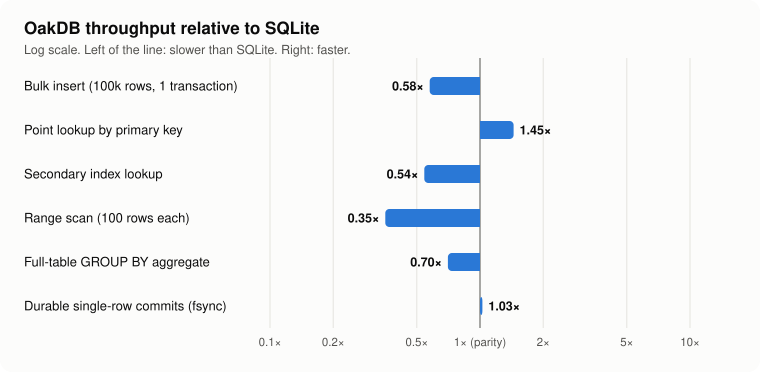
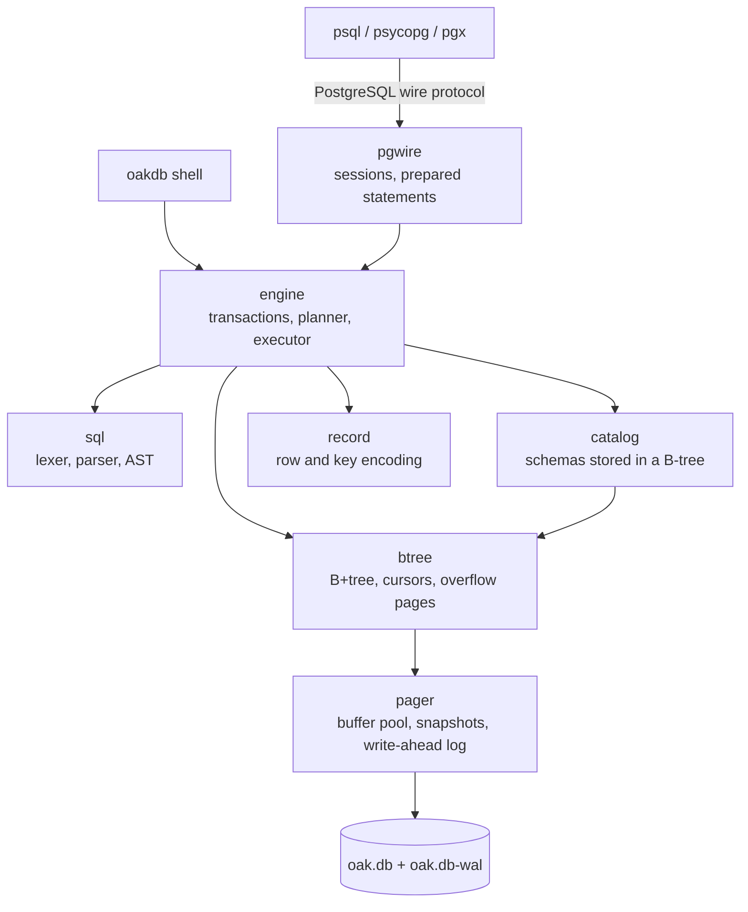

# OakDB

[](https://github.com/ibiraza1077-pixel/oakdb/actions/workflows/ci.yml)


**A SQL database built from scratch in Go.** It stores data in an on-disk B+tree, survives crashes through a write-ahead log, runs transactions with snapshot isolation, plans queries with indexes and hash joins, and speaks the PostgreSQL wire protocol, so `psql`, Python's `psycopg` and Go's `pgx` connect to it as if it were Postgres.

No database libraries: every layer, from the bytes on disk to the network protocol, is implemented here.

```console
$ oakdb serve
oakdb database oak.db, PostgreSQL protocol on 127.0.0.1:5433
oakdb dashboard on http://127.0.0.1:8080

$ psql "postgres://localhost:5433/oakdb?sslmode=disable"
oakdb=> CREATE TABLE users (id INTEGER PRIMARY KEY, name TEXT NOT NULL, city TEXT);
oakdb=> CREATE INDEX users_city ON users (city);
oakdb=> INSERT INTO users (name, city) VALUES ('Ada', 'London'), ('Linus', 'Helsinki'), ('Alan', 'London');
oakdb=> EXPLAIN SELECT count(*) FROM users WHERE city = 'London';
                          QUERY PLAN
-------------------------------------------------------------
 Project (count(*))
 ->  Aggregate (count(*))
   ->  Filter: (city = 'London')
     ->  Index Only Scan using users_city on users (city = 'London')
```

## Highlights

- **Storage engine.** 4 KB slotted pages and a B+tree with node splits, merges, rebalancing, overflow pages for large values and a free list that reuses space.
- **Crash safety.** A write-ahead log with a chained CRC-64 checksum on every frame. A crash at any moment, even halfway through writing a page, recovers to the last committed transaction. This is proven by a test that kills the process with `SIGKILL` dozens of times mid-write.
- **Transactions.** `BEGIN` / `COMMIT` / `ROLLBACK` with snapshot isolation: readers never block and never see partial work, and conflicting writers get a serialization error instead of corrupting each other's data. Schema changes are transactional too.
- **Query engine.** A hand-written SQL parser and a rule-based planner. It picks primary-key lookups, index scans, **index-only scans**, IN-list lookups and key ranges, and chooses between **index nested-loop, hash and nested-loop joins**. Expressions are compiled to closures and run on a Volcano-style iterator executor.
- **SQL.** `SELECT` with `WHERE`, inner and `LEFT JOIN`, `GROUP BY` / `HAVING`, `ORDER BY`, `LIMIT` / `OFFSET`, `DISTINCT`, `CASE`, `CAST`, `IN`, `BETWEEN`, `LIKE` / `ILIKE`, aggregates (including `COUNT(DISTINCT ...)`), 15 scalar functions, plus `INSERT ... SELECT`, `UPDATE`, `DELETE`, `CREATE` / `DROP TABLE` / `INDEX`, `UNIQUE`, `NOT NULL`, primary keys and `EXPLAIN`.
- **PostgreSQL compatibility.** Simple and extended wire protocol (prepared statements, binary parameters and results, parameter type inference) and PostgreSQL error codes. It is tested with `pgx` (Go) and `psycopg` (Python).
- **Tooling.** An interactive shell (`oakdb shell`), an integrity checker (`oakdb check`) and a live monitoring dashboard.

## How it's tested

A database has to be right, not just fast. The tests include:

| Technique | What it proves |
|---|---|
| **Differential testing against SQLite** | About 30,000 random queries and 30,000 random writes run on both OakDB and SQLite, and the results must be identical. SQLite is one of the most thoroughly tested programs in existence, which makes it an excellent oracle. |
| **Crash testing** | A child process writes transactions and is killed with `SIGKILL` at random moments, mid-commit and mid-checkpoint. After every crash, every acknowledged transaction must be present, no partial transaction may appear, and the integrity check must pass. |
| **Torn-write recovery** | The write-ahead log is cut at random byte offsets and has bits flipped. Recovery must always produce exactly a prefix of the committed transactions. |
| **Concurrency** | Writers move money between accounts while readers sum every balance; the total must never change. Runs under Go's race detector. |
| **Fuzzing** | Go's native fuzzer hammers the SQL parser and the B-tree (millions of inputs) against panics and invariant violations. |
| **Real drivers** | `pgx` in four query modes and `psycopg` connect over TCP and run real workloads. |
| **Structural invariants** | `btree.Inspect` checks key order, separator bounds, equal leaf depth and the leaf chain after random operations. |
| **Coverage** | Over 80% of statements in the engine packages are exercised by the test suite. |

```bash
go test ./...                                          # everything (about 15 s)
OAKDB_DIFF_ITERS=20000 go test ./tests -run Differential  # longer differential run
OAKDB_CRASH_ROUNDS=200 go test ./tests -run Crash          # more crashes
go test ./internal/btree -fuzz FuzzTree                   # fuzz the B-tree
```

## Performance

OakDB is compared with native C SQLite on the same machine, with the same durability (every commit flushed to disk):



Primary-key lookups beat SQLite, and durable commits match it, because both are limited by the disk. Scans and inserts are within 2–3×. Full numbers, method and an honest discussion are in [docs/benchmarks.md](docs/benchmarks.md). Two profiling-driven optimisations from the project:

- **4.4× faster inserts:** new cells are spliced straight into the slotted page instead of decoding and re-encoding the whole node, and sequential keys use an "append split" so leaves stay full instead of half empty.
- **2.5× faster index lookups:** index-only scans answer queries from the index alone when it holds every column the query needs.

## Architecture



Each layer only talks to the one below it and is tested on its own. A query goes: **parse** → **plan** (choose access paths and join strategies) → **execute** (pull rows through iterators) → **B-tree cursors** → **pager** (buffer pool, then WAL, then data file).

Design write-ups, one per layer:

1. [Storage: pages, the B+tree and overflow pages](docs/storage.md)
2. [Durability: the write-ahead log, checkpoints and crash recovery](docs/durability.md)
3. [Transactions and isolation](docs/transactions.md)
4. [The query engine: parsing, planning and execution](docs/query-engine.md)
5. [The PostgreSQL wire protocol](docs/wire-protocol.md)
6. [Testing a database](docs/testing.md)

Revising for an interview about the project? Start with the [interview guide](docs/interview-guide.md).

## Quick start

You need Go 1.23 or newer.

```bash
git clone https://github.com/ibiraza1077-pixel/oakdb && cd oakdb
go build -o oakdb ./cmd/oakdb

./oakdb shell -data demo.db       # embedded SQL shell (\? for help)
./oakdb serve -data demo.db       # server on :5433, dashboard on :8080
./oakdb check -data demo.db       # verify every table and index
```

Connect from anything that speaks PostgreSQL:

```bash
psql "postgres://localhost:5433/oakdb?sslmode=disable"
```

```python
import psycopg
with psycopg.connect("postgresql://localhost:5433/oakdb?sslmode=disable") as conn:
    print(conn.execute("SELECT version()").fetchone())
```

## Design choices and limits

These are deliberate trade-offs, chosen to keep the core small enough to reason about completely:

- **One writer at a time, many readers.** This is the same model as SQLite. Readers use snapshots, so they never wait. Multi-writer MVCC is the natural next step.
- **Rule-based planner.** There are no table statistics, so join order follows the query and access paths follow a fixed preference order. A cost-based optimiser with `ANALYZE` would come next.
- **No subqueries, `UNION`, window functions, outer joins other than `LEFT`, or `DATE` / `NUMERIC` types yet.** Unsupported SQL fails with a clear error and a PostgreSQL error code.
- **Trust authentication and no TLS.** The server binds to localhost by default.

## Project layout

```
cmd/oakdb       server, shell, check command, monitoring dashboard
cmd/oakbench    benchmark against SQLite
internal/pager  pages, buffer pool, write-ahead log, snapshots
internal/btree  B+tree, cursors, overflow pages, invariant checker
internal/record value types, row encoding, order-preserving key encoding
internal/sql    lexer, parser, AST
internal/catalog table and index definitions
internal/engine sessions, transactions, planner, executor, DML and DDL
internal/pgwire PostgreSQL wire protocol server
tests/          differential, crash, concurrency and client-driver tests
docs/           design write-ups and benchmarks
```

## Author

Built by [Ibrahim Raza](https://github.com/ibiraza1077-pixel) as a final-year Computer Science project, with an AI pair programmer. MIT licensed.
